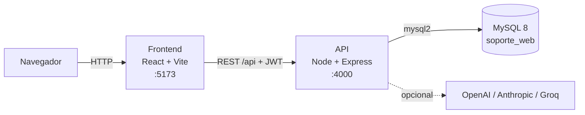
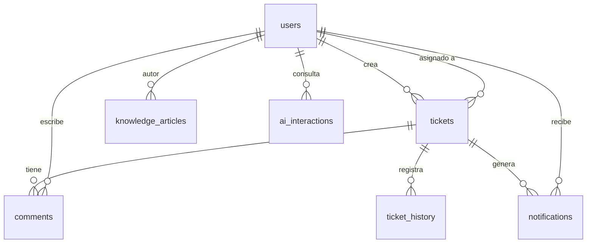

# SoporteWeb

Mesa de ayuda con tickets, comentarios, notificaciones, base de conocimiento y un asistente de IA que responde usando esas guías.

**Tecnologías:** React 18 + Vite (interfaz) · Node.js 20 + Express (API) · MySQL 8 · OpenAI, Anthropic o Groq (opcional).

## Contenido

1. [Arquitectura](#arquitectura)
2. [Estructura del proyecto](#estructura-del-proyecto)
3. [Modelo de datos](#modelo-de-datos)
4. [Puesta en marcha](#puesta-en-marcha)
5. [Roles y permisos](#roles-y-permisos)
6. [Comandos útiles](#comandos-útiles)
7. [Solución de problemas](#solución-de-problemas)
8. [Seguridad](#seguridad)
9. [Antes de publicar en internet](#antes-de-publicar-en-internet)

---

## Arquitectura



El proyecto es una aplicación de tres capas:

| Capa | Qué hace |
|---|---|
| **Frontend** (`frontend/`) | Interfaz de una sola página. Guarda la sesión (token JWT) y consume la API con `axios`. |
| **API** (`backend/`) | Valida la sesión, aplica permisos por rol, ejecuta la lógica y accede a la base de datos. |
| **Base de datos** (`database/`) | MySQL 8 con el esquema y las guías de ejemplo. |

### Cómo viaja una petición en la API

```
Petición → routes → middleware → controllers → services → models → MySQL
```

| Paso | Responsabilidad |
|---|---|
| `routes/` | Define las URL (`/api/tickets`, `/api/auth`…) y qué middleware lleva cada una. |
| `middleware/` | Autenticación (`auth`), permisos por rol (`roleGuard`), límite de intentos (`loginThrottle`, `rateLimit`) y manejo central de errores (`errorHandler`). |
| `controllers/` | Reciben la petición HTTP y devuelven la respuesta. Sin lógica de negocio. |
| `services/` | Reglas de negocio: validaciones, contraseñas, tokens, llamadas a la IA. |
| `models/` | Consultas SQL. Es la única capa que toca la base de datos. |

Los errores se lanzan con un `status` HTTP y los recoge `errorHandler`; cualquier error sin `status` responde `500 Error interno del servidor` y el detalle real queda en la consola del servidor.

---

## Estructura del proyecto

```
.
├── package.json            Scripts de la raíz: setup, dev, db:up, db:setup, build
├── docker-compose.yml      MySQL 8.4 para desarrollo (puerto 3307 del equipo)
├── backend/
│   ├── package.json
│   ├── scripts/            Utilidades de instalación (se ejecutan con npm run …)
│   │   ├── init-env.js       Crea backend/.env con un JWT_SECRET aleatorio
│   │   ├── db-setup.js       Crea la base, aplica el esquema, el admin y las guías
│   │   └── create-admin.js   Crea/promueve un administrador o restablece su clave
│   └── src/
│       ├── server.js         Arranque de Express, CORS, rutas y /api/health
│       ├── config/db.js      Pool de conexiones MySQL (lee DB_* del .env)
│       ├── routes/           ai · auth · categories · dashboard · knowledge · tickets · users
│       ├── controllers/      Un controlador por recurso
│       ├── middleware/       auth · roleGuard · loginThrottle · rateLimit · errorHandler
│       ├── services/         AuthService · TicketService · KnowledgeService · OpenAIService
│       └── models/           User · Ticket · Comment · TicketHistory · Notification ·
│                             Category · Knowledge · AIInteraction · Role
├── frontend/
│   ├── package.json
│   └── src/
│       ├── main.jsx · App.jsx  Punto de entrada y vistas principales
│       ├── api.js              Cliente axios (añade el token a cada petición)
│       ├── context/            AuthContext: usuario y sesión actuales
│       ├── layouts/            MainLayout: cabecera + barra lateral
│       ├── pages/              Login · Register · Dashboard · Tickets · TicketDetail ·
│       │                       Knowledge · ArticleDetail · AIChat · Notifications ·
│       │                       Users · Settings
│       ├── components/         Sidebar · Header · TicketCard · TicketModal · KnowledgeCard ·
│       │                       MetricsCard · Charts · ChatBot · NotificationBell · ProtectedRoute
│       ├── services/           Llamadas a la API por recurso (auth, tickets, knowledge, IA…)
│       └── styles.css
└── database/
    ├── schema.sql                      Esquema completo e idempotente
    └── seed-knowledge-general.sql      26 guías de ejemplo para la base de conocimiento
```

### Variables de entorno (`backend/.env`)

El archivo se crea con `npm run setup` y **nunca se sube a git** (está en `.gitignore`).

| Variable | Descripción |
|---|---|
| `DB_HOST`, `DB_PORT`, `DB_NAME`, `DB_USER`, `DB_PASSWORD` | Conexión a MySQL. Con el Docker de este repo: `127.0.0.1`, `3307`, `soporte_web`, `root`, `soporte_dev`. |
| `JWT_SECRET` | Clave para firmar las sesiones. La genera `npm run setup`. |
| `PORT` | Puerto de la API (por defecto `4000`). |
| `CLIENT_URL` | Dirección de la interfaz permitida por CORS (por defecto `http://localhost:5173`). |
| `ADMIN_EMAIL`, `ADMIN_NAME`, `ADMIN_PASSWORD` | Cuenta de administrador que crea `db:setup` (clave de mínimo 8 caracteres). |
| `NODE_ENV` | `production` en producción: la API se niega a arrancar con el `JWT_SECRET` de ejemplo. |
| `TRUST_PROXY` | Número de proxies inversos delante de la API (ver [producción](#antes-de-publicar-en-internet)). |
| `AI_PROVIDER` | Proveedor de IA: `openai` (por defecto), `anthropic` o `groq`. Cualquier otro valor da error 503. |
| `OPENAI_API_KEY`, `OPENAI_MODEL` | Con `AI_PROVIDER=openai`. El modelo por defecto es `gpt-4o-mini`. |
| `ANTHROPIC_API_KEY`, `ANTHROPIC_MODEL` | Con `AI_PROVIDER=anthropic`. **`ANTHROPIC_MODEL` es obligatorio**: sin él la API responde 503. |
| `GROQ_API_KEY`, `GROQ_MODEL` | Con `AI_PROVIDER=groq`. El modelo por defecto es `openai/gpt-oss-20b`. |

La IA es opcional: sin la clave del proveedor elegido, el asistente responde con el texto de las guías.

---

## Modelo de datos



| Tabla | Contenido |
|---|---|
| `users` | Cuentas. El rol (`user`, `agent`, `admin`) vive aquí. **Nunca se borran**: se desactivan (`is_active = 0`) y conservan su historial. `token_version` invalida sesiones al cambiar la contraseña. |
| `tickets` | Solicitudes: asunto, descripción, categoría, prioridad (`Baja`…`Urgente`) y estado (`Abierto`, `En progreso`, `Cerrado`). |
| `comments` | Comentarios de cada ticket. |
| `ticket_history` | Registro de cambios de cada ticket. |
| `notifications` | Avisos para los usuarios (con marca de lectura). |
| `categories` | Categorías compartidas por tickets y base de conocimiento. |
| `knowledge_articles` | Guías de la base de conocimiento; las usa también el asistente de IA. |
| `ai_interactions` | Preguntas al asistente, respuesta, artículos usados y valoración. |
| `roles` | Tabla de referencia; la API no la usa. |

---

## Puesta en marcha

### 1. Qué necesitas instalar

| Programa | Para qué | Cómo comprobar que está bien |
|---|---|---|
| **Node.js 20 o superior** (LTS, nodejs.org) | Ejecutar la API y la interfaz | `node -v` debe mostrar `v20` o más |
| **Docker Desktop** *o* **MySQL 8** | Base de datos | — |
| **VS Code** | Editor | — |

Git es opcional: puedes descargar el proyecto como ZIP. Después de instalar Node.js, **cierra y vuelve a abrir VS Code**.

> **Windows:** si `npm` dice *"la ejecución de scripts está deshabilitada"*, usa una terminal **Command Prompt**, o ejecuta una vez en PowerShell: `Set-ExecutionPolicy -Scope CurrentUser RemoteSigned`

### 2. Base de datos (elige UNA opción)

**Opción A · Docker (la más simple).** Abre Docker Desktop y ejecuta `npm run db:up`. Crea un MySQL con usuario `root` y contraseña `soporte_dev`, accesible en el puerto **3307** del equipo.

**Opción B · MySQL instalado.** Instala MySQL Community Server 8, anota la contraseña de `root`, comprueba que el servicio está iniciado y pon esa contraseña en `DB_PASSWORD` (puerto `3306`).

### 3. Instalar y configurar

```bash
npm run setup
```

Instala las dependencias y crea `backend/.env`. Ábrelo y revisa `DB_PORT` (`3307` con Docker), `DB_PASSWORD`, `ADMIN_EMAIL`, `ADMIN_NAME` y `ADMIN_PASSWORD`.

Después crea la base, las tablas, el administrador y las guías de ejemplo:

```bash
npm run db:setup
```

Es repetible: no duplica ni borra nada.

### 4. Ejecutar

```bash
npm run dev
```

- Interfaz: <http://localhost:5173>
- API: <http://localhost:4000> · diagnóstico: <http://localhost:4000/api/health> (debe mostrar `"database":"ok"`)

Inicia sesión con `ADMIN_EMAIL` y `ADMIN_PASSWORD`. Las demás personas se registran desde la pantalla de acceso con rol **Usuario**; el administrador puede cambiar su rol en **Usuarios**.

### Empezar de cero (borra todos los datos)

- Docker: `docker compose down -v`, luego `npm run db:up` y `npm run db:setup`.
- MySQL local: `DROP DATABASE soporte_web;` y luego `npm run db:setup`.

### Actualizar una base de una versión anterior

Ejecuta `npm run db:setup` **antes de arrancar** la nueva versión: añade las columnas que falten sin tocar tus datos. Si lo olvidas, `/api/health` responde `"database":"outdated"`.

---

## Roles y permisos

| Rol | Puede |
|---|---|
| Usuario | Crear tickets, ver y comentar los suyos, usar el asistente y la base de conocimiento |
| Agente | Además: ver todos los tickets y cambiar su estado |
| Administrador | Además: gestionar usuarios, categorías y artículos |

El rol se lee de la base de datos en cada petición, así que un cambio surte efecto al instante.

---

## Comandos útiles

| Comando | Qué hace |
|---|---|
| `npm run setup` | Instala dependencias y crea `backend/.env` |
| `npm run dev` | Inicia API e interfaz |
| `npm run db:up` | Inicia MySQL con Docker |
| `npm run db:setup` | Crea/actualiza la base, el administrador y las guías (repetible) |
| `npm run create-admin` | Crea o promueve al administrador definido en `.env` |
| `npm --prefix backend run create-admin -- --email ana@empresa.com --name Ana --password clave12345` | Crea o promueve a otra cuenta |
| `npm --prefix backend run create-admin -- --email ana@empresa.com --password nueva12345 --reset-password` | Restablece una contraseña |
| `npm run build` | Compila la interfaz para producción |

---

## Solución de problemas

| Síntoma | Solución |
|---|---|
| `'node' no se reconoce` | Reinstala Node.js y reinicia VS Code |
| *No se pudo conectar a MySQL* | Inicia MySQL (`npm run db:up` o el servicio). Revisa `DB_HOST`/`DB_PORT` (`3307` con Docker) |
| *MySQL rechazó el usuario o la contraseña* | Corrige `DB_USER` y `DB_PASSWORD` en `backend/.env` |
| *Port 3307 / 3306 is already allocated* | Otro programa usa ese puerto: ciérralo o cambia el mapeo en `docker-compose.yml` y `DB_PORT` |
| *El puerto 4000/5173 ya está en uso* | Cierra el otro programa o cambia `PORT` en `backend/.env` |
| *Falta JWT_SECRET* | Ejecuta `npm run setup` |
| *Error interno del servidor* al registrarse o iniciar sesión | Mira el error real en la terminal de la API. Si dice `Table … doesn't exist`, ejecuta `npm run db:setup` |
| *Credenciales incorrectas* tras reiniciar la base | Si ejecutaste `down -v`, los usuarios se borraron: vuelve a crear la cuenta o ejecuta `npm run db:setup` |
| *La base de datos está vacía o desactualizada* | Ejecuta `npm run db:setup` y reinicia la API |
| No aparecen **Categorías** / **Usuarios** o el botón de añadir artículos | Esas opciones son solo para administradores: usa `npm run create-admin` |
| Tildes como `?` (`Colaboraci?n`) | Se cargó el SQL por una tubería de PowerShell (`Get-Content … \| docker exec …`), que no usa UTF-8. Usa `npm run db:setup`, o `docker cp` y `mysql … < archivo` **dentro** del contenedor. Para repararlo: empezar de cero |
| Te saca al login de repente | La sesión dura 8 horas, o cambiaron la contraseña de tu cuenta (cierra todas las sesiones). Vuelve a entrar |
| *Demasiados intentos de inicio de sesión* | Tras 5 fallos con el mismo correo y equipo se bloquea 15 minutos |
| Aviso `DEP0040 punycode` al arrancar | Es inofensivo (viene de una dependencia) |

---

## Seguridad

- Las contraseñas se guardan con `bcrypt`; las sesiones son tokens JWT de 8 horas.
- Cambiar la contraseña (desde **Configuración** o con `--reset-password`) cierra las demás sesiones.
- El inicio de sesión limita los intentos: 5 por correo y equipo, y 20 por correo desde cualquier equipo, cada 15 minutos. Los contadores viven en la memoria de la API y se reinician con ella.
- El `.env` y las claves nunca se suben al repositorio.

---

## Antes de publicar en internet

- Usa un `JWT_SECRET` propio y largo (con `NODE_ENV=production` la API se niega a arrancar con el de ejemplo).
- Cambia `DB_PASSWORD` y no uses `root` como usuario de la aplicación.
- Define `CLIENT_URL` con la dirección real de la interfaz y sirve todo por HTTPS.
- Si la API va detrás de un proxy inverso, define `TRUST_PROXY=1` (número de proxies); si no, todos los usuarios compartirían contador de intentos.
- Con varias instancias de la API (por ejemplo en Cloud Run), el límite de intentos y las cuotas de IA no se comparten: usa un almacén común (p. ej. Redis).
- Borra `ADMIN_PASSWORD` de `backend/.env` tras crear el administrador.
- Guarda `JWT_SECRET`, la clave de IA y la contraseña de la base en un gestor de secretos, no en el repositorio.
- En un servicio gestionado (Cloud SQL, RDS…), ejecuta `npm run db:setup` una vez apuntando a esa base: carga el SQL en UTF-8 y evita los problemas de codificación.