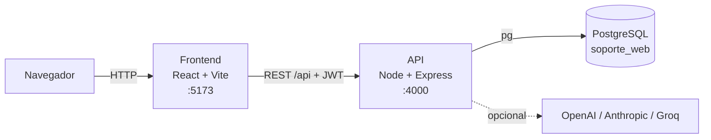
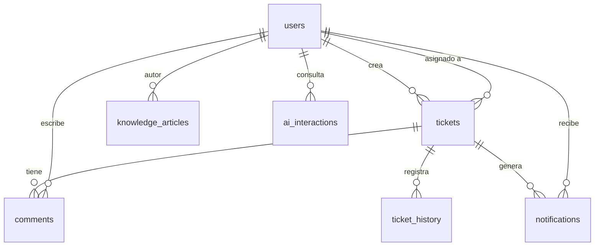

# SoporteWeb

Mesa de ayuda con tickets, comentarios, notificaciones, base de conocimiento y un asistente de IA que responde usando esas guías.

**Tecnologías:** React 18 + Vite (interfaz) · Node.js 20 + Express (API) · PostgreSQL · OpenAI, Anthropic o Groq (opcional).

## Contenido

1. [Arquitectura](#arquitectura)
2. [Estructura del proyecto](#estructura-del-proyecto)
3. [Modelo de datos](#modelo-de-datos)
4. [Puesta en marcha](#puesta-en-marcha)
5. [Roles y permisos](#roles-y-permisos)
6. [Comandos útiles](#comandos-útiles)
7. [Solución de problemas](#solución-de-problemas)
8. [Seguridad](#seguridad)
9. [Antes de publicar en internet](#antes-de-publicar-en-internet)

---

## Arquitectura



El proyecto es una aplicación de tres capas:

| Capa | Qué hace |
|---|---|
| **Frontend** (`frontend/`) | Interfaz de una sola página. Guarda la sesión (token JWT) y consume la API con `axios`. |
| **API** (`backend/`) | Valida la sesión, aplica permisos por rol, ejecuta la lógica y accede a la base de datos. |
| **Base de datos** (`database/`) | PostgreSQL con el esquema y las guías de ejemplo. |

### Cómo viaja una petición en la API

```
Petición → routes → middleware → controllers → services → models → PostgreSQL
```

| Paso | Responsabilidad |
|---|---|
| `routes/` | Define las URL (`/api/tickets`, `/api/auth`…) y qué middleware lleva cada una. |
| `middleware/` | Autenticación (`auth`), permisos por rol (`roleGuard`), límite de intentos (`loginThrottle`, `rateLimit`) y manejo central de errores (`errorHandler`). |
| `controllers/` | Reciben la petición HTTP y devuelven la respuesta. Sin lógica de negocio. |
| `services/` | Reglas de negocio: validaciones, contraseñas, tokens, llamadas a la IA. |
| `models/` | Consultas SQL. Es la única capa que toca la base de datos. |

Los errores se lanzan con un `status` HTTP y los recoge `errorHandler`; cualquier error sin `status` responde `500 Error interno del servidor` y el detalle real queda en la consola del servidor.

---

## Estructura del proyecto

```
.
├── README.md
├── package.json              Scripts de la raíz: setup, dev, db:up, db:setup, create-admin, build
├── package-lock.json
├── docker-compose.yml        PostgreSQL 16 para desarrollo (puerto 5433 del equipo)
├── render.yaml               Blueprint de Render: despliegue de la API (backend)
├── neon.ts                   Configuración de la CLI de Neon (ramas); la app no lo usa
├── skills-lock.json          Versiones de las skills de Neon para asistentes de IA
├── .gitignore                Excluye .env, node_modules, dist y copias de seguridad
├── .github/
│   └── workflows/
│       └── deploy-pages.yml  Compila el frontend y lo publica en GitHub Pages
├── .agents/skills/           Documentación de Neon para asistentes de IA (no es parte de la app)
├── .vscode/
│   └── mcp.json              Conexión de VS Code al servidor MCP de Neon (herramienta de desarrollo)
│
├── backend/                  API REST (Node.js + Express)
│   ├── Dockerfile            Imagen opcional para otro host con contenedores (hoy el despliegue usa Render sin Docker)
│   ├── .dockerignore         Mantiene .env y node_modules fuera de la imagen
│   ├── .gitignore            Refuerza que .env no se versione
│   ├── .env.example          Plantilla de variables de entorno (el .env real no se sube)
│   ├── package.json
│   ├── package-lock.json
│   ├── scripts/              Utilidades que se ejecutan con npm run …
│   │   ├── env.js              Ayudas compartidas por los scripts (lectura de variables)
│   │   ├── init-env.js         Crea backend/.env con un JWT_SECRET aleatorio
│   │   ├── db-setup.js         Crea la base, aplica el esquema, el admin y las guías
│   │   └── create-admin.js     Crea/promueve un administrador o restablece su clave
│   └── src/
│       ├── server.js           Arranque de Express, CORS, rutas y /api/health
│       ├── config/
│       │   └── db.js             Pool PostgreSQL (DATABASE_URL o host/puerto)
│       ├── routes/             ai · auth · categories · dashboard · knowledge · tickets · users
│       ├── controllers/        AI · Auth · Category · Dashboard · Knowledge · Ticket · User
│       ├── middleware/         auth · roleGuard · loginThrottle · rateLimit · errorHandler
│       ├── services/           AuthService · TicketService · KnowledgeService ·
│       │                       OpenAIService (proveedor de IA: OpenAI, Anthropic o Groq)
│       └── models/             User · Ticket · Comment · TicketHistory · Notification ·
│                               Category · Knowledge · AIInteraction · Role
│
├── frontend/                 Interfaz (React 18 + Vite)
│   ├── Dockerfile            Imagen opcional con nginx (hoy el frontend se publica en GitHub Pages)
│   ├── .dockerignore
│   ├── nginx.conf.template   Configuración de nginx (SPA, caché, puerto ${PORT})
│   ├── .env.example          VITE_API_URL (dirección de la API) y VITE_BASE_PATH (ruta de Pages); se fijan al compilar
│   ├── index.html
│   ├── vite.config.js        Usa VITE_BASE_PATH como `base` (GitHub Pages sirve en /<repositorio>/)
│   ├── package.json
│   ├── package-lock.json
│   └── src/
│       ├── main.jsx · App.jsx  Punto de entrada y vistas principales
│       ├── api.js              Cliente axios (añade el token a cada petición)
│       ├── styles.css
│       ├── context/            AuthContext: usuario y sesión actuales
│       ├── layouts/            MainLayout: cabecera + barra lateral
│       ├── pages/              Login · Register · Dashboard · Tickets · TicketDetail ·
│       │                       Knowledge · ArticleDetail · AIChat · Notifications ·
│       │                       Users · Settings
│       ├── components/         Sidebar · Header · TicketCard · TicketModal · StatusPicker ·
│       │                       KnowledgeCard · MetricsCard · Charts · ChatBot ·
│       │                       NotificationBell · ProtectedRoute
│       ├── services/           Llamadas a la API por recurso (auth, tickets, knowledge,
│       │                       notificaciones, IA)
│       └── utils/
│           └── roles.js        Ayudas para comprobar roles en la interfaz
│
└── database/
    ├── schema.sql                      Esquema completo e idempotente
    └── seed-knowledge-general.sql      26 guías de ejemplo para la base de conocimiento
```

### Variables de entorno (`backend/.env`)

El archivo se crea con `npm run setup` y **nunca se sube a git** (está en `.gitignore`).

| Variable | Descripción |
|---|---|
| `DATABASE_URL` | Cadena de conexión PostgreSQL (Neon en producción; opcional si usas las variables `DB_*`). |
| `DB_HOST`, `DB_PORT`, `DB_NAME`, `DB_USER`, `DB_PASSWORD` | Conexión PostgreSQL local. Con Docker: `127.0.0.1`, `5433`, `soporte_web`, `soporte_web`, `soporte_dev`. |
| `JWT_SECRET` | Clave para firmar las sesiones. La genera `npm run setup`. |
| `PORT` | Puerto de la API (por defecto `4000`). |
| `CLIENT_URL` | Dirección de la interfaz permitida por CORS (por defecto `http://localhost:5173`). |
| `ADMIN_EMAIL`, `ADMIN_NAME`, `ADMIN_PASSWORD` | Cuenta de administrador que crea `db:setup` (clave de mínimo 8 caracteres). |
| `NODE_ENV` | `production` en producción: la API se niega a arrancar con el `JWT_SECRET` de ejemplo. |
| `TRUST_PROXY` | Número de proxies inversos delante de la API (ver [producción](#antes-de-publicar-en-internet)). |
| `AI_PROVIDER` | Proveedor de IA: `openai` (por defecto), `anthropic` o `groq`. Cualquier otro valor da error 503. |
| `OPENAI_API_KEY`, `OPENAI_MODEL` | Con `AI_PROVIDER=openai`. El modelo por defecto es `gpt-4o-mini`. |
| `ANTHROPIC_API_KEY`, `ANTHROPIC_MODEL` | Con `AI_PROVIDER=anthropic`. **`ANTHROPIC_MODEL` es obligatorio**: sin él la API responde 503. |
| `GROQ_API_KEY`, `GROQ_MODEL` | Con `AI_PROVIDER=groq`. El modelo por defecto es `openai/gpt-oss-20b`. |

La IA es opcional: sin la clave del proveedor elegido, el asistente responde con el texto de las guías.

---

## Modelo de datos



| Tabla | Contenido |
|---|---|
| `users` | Cuentas. El rol (`user`, `agent`, `admin`) vive aquí. **Nunca se borran**: se desactivan (`is_active = 0`) y conservan su historial. `token_version` invalida sesiones al cambiar la contraseña. |
| `tickets` | Solicitudes: asunto, descripción, categoría, prioridad (`Baja`…`Urgente`) y estado (`Abierto`, `En progreso`, `Cerrado`). |
| `comments` | Comentarios de cada ticket. |
| `ticket_history` | Registro de cambios de cada ticket. |
| `notifications` | Avisos para los usuarios (con marca de lectura). |
| `categories` | Categorías compartidas por tickets y base de conocimiento. |
| `knowledge_articles` | Guías de la base de conocimiento; las usa también el asistente de IA. |
| `ai_interactions` | Preguntas al asistente, respuesta, artículos usados y valoración. |
| `roles` | Tabla de referencia; la API no la usa. |

---

## Puesta en marcha

### 1. Qué necesitas instalar

| Programa | Para qué | Cómo comprobar que está bien |
|---|---|---|
| **Node.js 20 o superior** (LTS, nodejs.org) | Ejecutar la API y la interfaz | `node -v` debe mostrar `v20` o más |
| **Docker Desktop** *o* **Neon PostgreSQL** | Base de datos | — |
| **VS Code** | Editor | — |

Git es opcional: puedes descargar el proyecto como ZIP. Después de instalar Node.js, **cierra y vuelve a abrir VS Code**.

> **Windows:** si `npm` dice *"la ejecución de scripts está deshabilitada"*, usa una terminal **Command Prompt**, o ejecuta una vez en PowerShell: `Set-ExecutionPolicy -Scope CurrentUser RemoteSigned`

### 2. Base de datos (elige UNA opción)

**Opción A · Docker (la más simple).** Abre Docker Desktop y ejecuta `npm run db:up`. Crea PostgreSQL con usuario y base `soporte_web`, contraseña `soporte_dev`, accesible en el puerto **5433** del equipo.

**Opción B · Neon.** Crea un proyecto PostgreSQL gratuito y copia su cadena de conexión en `DATABASE_URL` en `backend/.env`.

### 3. Instalar y configurar

```bash
npm run setup
```

Instala las dependencias y crea `backend/.env`. Ábrelo y revisa la conexión a la base y `ADMIN_EMAIL`, `ADMIN_NAME` y `ADMIN_PASSWORD`. Si ya tenías `.env`, el comando no lo sobrescribe: actualiza manualmente los valores antiguos de MySQL.

Después crea la base, las tablas, el administrador y las guías de ejemplo:

```bash
npm run db:setup
```

Es repetible: no duplica ni borra nada.

### 4. Ejecutar

```bash
npm run dev
```

- Interfaz: <http://localhost:5173>
- API: <http://localhost:4000> · diagnóstico: <http://localhost:4000/api/health> (debe mostrar `"database":"ok"`)

Inicia sesión con `ADMIN_EMAIL` y `ADMIN_PASSWORD`. Las demás personas se registran desde la pantalla de acceso con rol **Usuario**; el administrador puede cambiar su rol en **Usuarios**.

### Empezar de cero (borra todos los datos)

- Docker: elimina únicamente el volumen local `soporte_pg_data`, luego `npm run db:up` y `npm run db:setup`.
- Neon: usa un proyecto de prueba nuevo; `npm run db:setup` es idempotente y no elimina tablas ni datos.

### Volver a preparar el esquema

`npm run db:setup` se puede repetir: crea los objetos que falten y añade las guías de ejemplo que no existan, sin borrar datos. Las versiones anteriores usaban MySQL; sus tablas y datos no se migran automáticamente a PostgreSQL. Si tenías el contenedor MySQL antiguo (`soporteweb-db`), elimínalo antes de levantar el nuevo: `docker rm -f soporteweb-db`, y después `npm run db:up`.

---

## Roles y permisos

| Rol | Puede |
|---|---|
| Usuario | Crear tickets, ver y comentar los suyos, usar el asistente y la base de conocimiento |
| Agente | Además: ver todos los tickets y cambiar su estado |
| Administrador | Además: gestionar usuarios, categorías y artículos |

El rol se lee de la base de datos en cada petición, así que un cambio surte efecto al instante.

---

## Comandos útiles

| Comando | Qué hace |
|---|---|
| `npm run setup` | Instala dependencias y crea `backend/.env` |
| `npm run dev` | Inicia API e interfaz |
| `npm run db:up` | Inicia PostgreSQL con Docker |
| `npm run db:setup` | Crea/actualiza la base, el administrador y las guías (repetible) |
| `npm run create-admin` | Crea o promueve al administrador definido en `.env` |
| `npm --prefix backend run create-admin -- --email ana@empresa.com --name Ana --password clave12345` | Crea o promueve a otra cuenta |
| `npm --prefix backend run create-admin -- --email ana@empresa.com --password nueva12345 --reset-password` | Restablece una contraseña |
| `npm run build` | Compila la interfaz para producción |

---

## Solución de problemas

| Síntoma | Solución |
|---|---|
| `'node' no se reconoce` | Reinstala Node.js y reinicia VS Code |
| *No se pudo conectar a PostgreSQL* | Inicia PostgreSQL (`npm run db:up`) o revisa `DATABASE_URL` / `DB_HOST` y `DB_PORT` (`5433` con Docker) |
| *La base rechazó el usuario o la contraseña* | Corrige la cadena `DATABASE_URL` o `DB_USER` y `DB_PASSWORD` en `backend/.env` |
| *Port 5433 is already allocated* | Otro programa usa ese puerto: ciérralo o cambia el mapeo en `docker-compose.yml` y `DB_PORT` |
| *El puerto 4000/5173 ya está en uso* | Cierra el otro programa o cambia `PORT` en `backend/.env` |
| *Falta JWT_SECRET* | Ejecuta `npm run setup` |
| *Error interno del servidor* al registrarse o iniciar sesión | Mira el error real en la terminal de la API. Si dice `Table … doesn't exist`, ejecuta `npm run db:setup` |
| *Credenciales incorrectas* tras reiniciar la base | Si ejecutaste `down -v`, los usuarios se borraron: vuelve a crear la cuenta o ejecuta `npm run db:setup` |
| *La base de datos está vacía o desactualizada* | Ejecuta `npm run db:setup` y reinicia la API |
| No aparecen **Categorías** / **Usuarios** o el botón de añadir artículos | Esas opciones son solo para administradores: usa `npm run create-admin` |
| Tildes como `?` (`Colaboraci?n`) | Comprueba que los archivos SQL se guardaron como UTF-8 y vuelve a ejecutar `npm run db:setup`. |
| Te saca al login de repente | La sesión dura 8 horas, o cambiaron la contraseña de tu cuenta (cierra todas las sesiones). Vuelve a entrar |
| *Demasiados intentos de inicio de sesión* | Tras 5 fallos con el mismo correo y equipo se bloquea 15 minutos |
| Aviso `DEP0040 punycode` al arrancar | Es inofensivo (viene de una dependencia) |
| `container name "/soporteweb-db" is already in use` | Queda el contenedor MySQL de la versión anterior: `docker rm -f soporteweb-db` y luego `npm run db:up` |
| VS Code marca error en `neon.ts` (*Cannot find module `@neon/config/v1`*, `branch` implícito) | Faltan las dependencias de la raíz: ejecuta `npm install` en la carpeta principal y reinicia el servidor de TypeScript (*Ctrl+Shift+P → TypeScript: Restart TS Server*). `neon.ts` solo lo usa la CLI de Neon; la aplicación no lo necesita |
| En producción, la primera petición tarda o falla | El plan gratuito de Render duerme la API tras un rato sin uso: espera unos segundos y reintenta |
| La interfaz en Pages carga pero no deja entrar (error de red o CORS) | En Render, `CLIENT_URL` debe ser el origen de Pages **sin ruta**: `https://feliperoma04.github.io`. Comprueba también la variable `VITE_API_URL` del repositorio |

---

## Seguridad

- Las contraseñas se guardan con `bcrypt`; las sesiones son tokens JWT de 8 horas.
- Cambiar la contraseña (desde **Configuración** o con `--reset-password`) cierra las demás sesiones.
- El inicio de sesión limita los intentos: 5 por correo y equipo, y 20 por correo desde cualquier equipo, cada 15 minutos. Los contadores viven en la memoria de la API y se reinician con ella.
- El `.env` y las claves nunca se suben al repositorio.

---

## Antes de publicar en internet

- Usa un `JWT_SECRET` propio y largo (con `NODE_ENV=production` la API se niega a arrancar con el de ejemplo).
- Usa una cadena `DATABASE_URL` privada y no la guardes en el repositorio.
- Define `CLIENT_URL` con la dirección real de la interfaz y sirve todo por HTTPS.
- Si la API va detrás de un proxy inverso, define `TRUST_PROXY=1` (número de proxies); si no, todos los usuarios compartirían contador de intentos.
- Con varias instancias de la API (por ejemplo en Render con varias réplicas), el límite de intentos y las cuotas de IA no se comparten: usa un almacén común (p. ej. Redis).
- Borra `ADMIN_PASSWORD` de `backend/.env` tras crear el administrador.
- Guarda `JWT_SECRET`, la clave de IA y la contraseña de la base en un gestor de secretos, no en el repositorio.
- En una base PostgreSQL gestionada, ejecuta `npm run db:setup` una vez apuntando a esa base. El script prepara el esquema y carga ejemplos sin borrar datos existentes.

## Despliegue gratuito (GitHub Pages + Render + Neon)

**En línea:**

| Servicio | Dirección |
|---|---|
| Interfaz (GitHub Pages) | <https://feliperoma04.github.io/soporteWeb/> |
| API (Render) · diagnóstico | <https://soporte-web-api.onrender.com/api/health> |
| Base de datos | Neon (PostgreSQL), accesible solo con su cadena de conexión |


El frontend estático se publica en GitHub Pages; la API Express se ejecuta en Render; Neon aloja PostgreSQL. GitHub Pages no puede ejecutar el backend ni la base de datos.

1. Crea una base de datos en [Neon](https://neon.tech/), activa **Connection pooling** y copia la cadena de conexión pooled PostgreSQL (la dirección del host suele incluir `-pooler`).
2. En `backend/.env`, define `DATABASE_URL`, `ADMIN_NAME`, `ADMIN_EMAIL` y una contraseña fuerte para `ADMIN_PASSWORD`. Ejecuta `npm run db:setup` desde la raíz para crear el esquema, el administrador y las guías de ejemplo en Neon. No se copian datos que estén en tu antigua base MySQL.
3. En Render, crea un Blueprint desde el repositorio usando [`render.yaml`](./render.yaml). Configura `DATABASE_URL` con la cadena de Neon y `CLIENT_URL` con el origen de GitHub Pages, por ejemplo `https://feliperoma04.github.io`. Render genera `JWT_SECRET`.
4. En GitHub, crea la variable de repositorio `VITE_API_URL` con la URL de la API de Render seguida de `/api`, por ejemplo `https://soporte-web-api.onrender.com/api`.
5. En **Settings → Pages**, selecciona **GitHub Actions** como origen. Al subir cambios a `main`, [el workflow](./.github/workflows/deploy-pages.yml) compila el frontend y lo publica en Pages.

Los niveles gratuitos tienen límites. El servicio gratuito de Render puede tardar en despertar tras un periodo sin actividad; Neon también aplica límites de uso. La IA es opcional y el proveedor de IA podría tener sus propios costes o límites.

### Crear o promover un administrador en producción

Cualquier persona que se registra en la interfaz queda con rol **Usuario**. El primer administrador se crea fuera de la aplicación, con acceso a la base de Neon. Hay dos formas:

1. **Con la consola SQL de Neon** (la más rápida). Quien tenga acceso al proyecto, tras registrarse la cuenta en la interfaz, ejecuta:

   ```sql
   UPDATE users SET role = 'admin', token_version = token_version + 1 WHERE email = 'correo@ejemplo.com';
   ```

   La persona debe cerrar sesión y volver a entrar.

2. **Con el script del proyecto.** Desde la raíz, con `DATABASE_URL` de Neon en `backend/.env` o en la terminal:

   ```bash
   npm --prefix backend run create-admin -- --email correo@ejemplo.com --name "Nombre" --password "clave-de-8-o-mas"
   ```

   Si la cuenta ya existe, la promueve; si no, la crea. Añade `--reset-password` para cambiar su contraseña.

La cadena de conexión de Neon es un secreto: compártela solo por un canal privado y no la subas al repositorio.